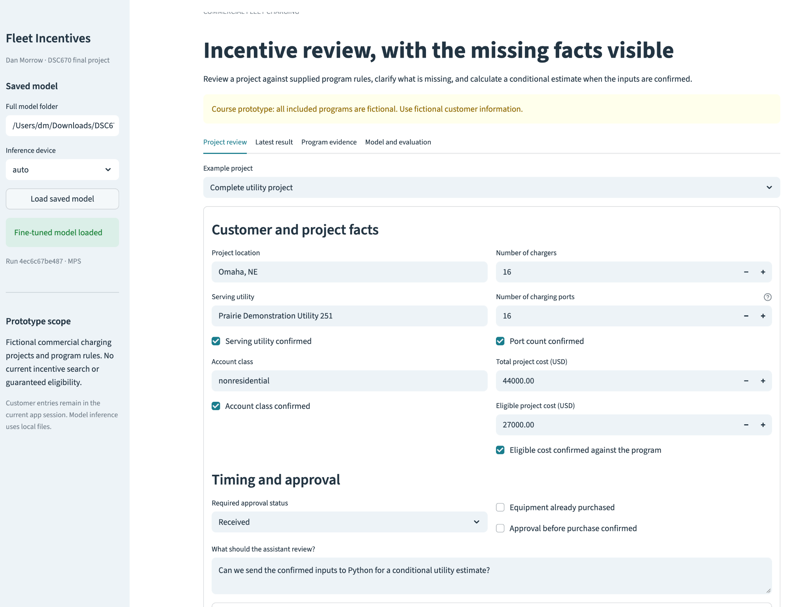
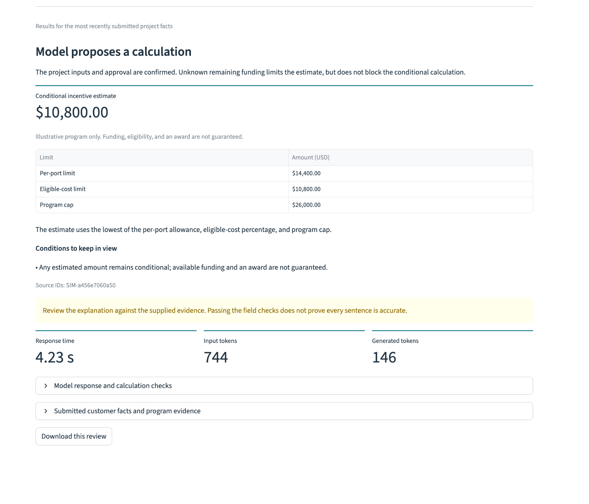
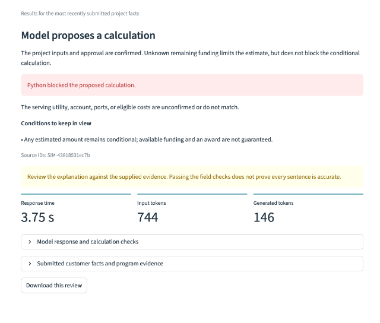
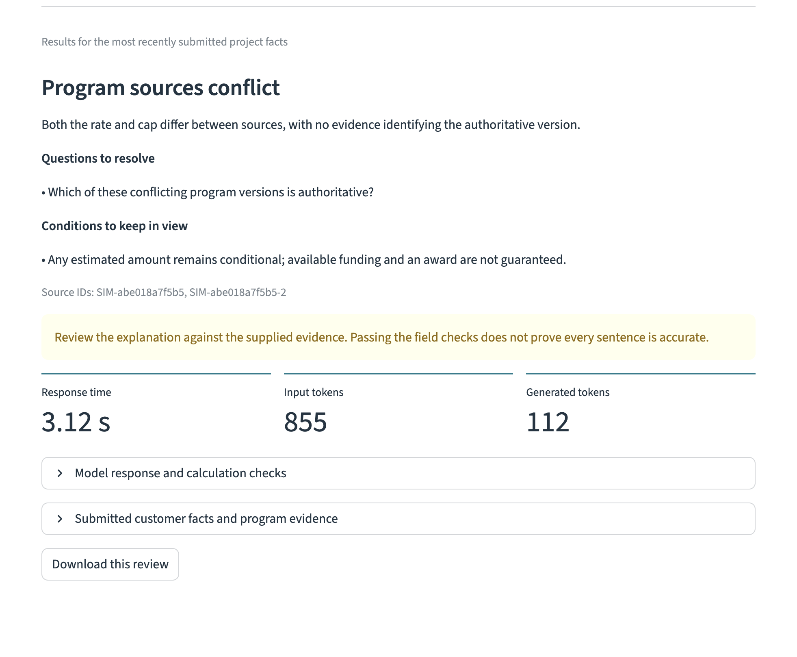

# Commercial Fleet EV Incentive Assistant

## Business Problem

Fleet charging incentive information is scattered, eligibility depends on customer and project details, and a plausible estimate can be misleading when required information is missing. This prototype explores an assistant that asks for clarification, follows supplied program rules, and passes confirmed inputs to Python for calculations.

## DTE Full Fine-Tuning Notebook — Prepared, Not Yet Run

The [DTE training notebook](commercial_fleet_ev_incentive_assistant_dte_full_fine_tuning.ipynb) prepares a fresh full fine-tuning run from the pinned Qwen2.5-0.5B-Instruct base revision. It uses 320 training, 64 validation, and 64 fresh test examples, with related projects kept together and test port counts and task wording separated from training. It does not update the original saved model.

[Open in Colab](https://colab.research.google.com/github/danof2morrow/data-science-portfolio/blob/main/generative-ai/commercial-fleet-ev-incentive-assistant/commercial_fleet_ev_incentive_assistant_dte_full_fine_tuning.ipynb). Select a T4 GPU and run the cells in order. The notebook saves a separate full model, reports, and an application configured for its new run identity. It downloads a small results report after evaluation. New GPU training and new model-performance results are not claimed yet.

The notebook schema, Python syntax, split separation, label/calculator fixtures, complete token lengths, and export format were checked locally. The export test used an explicitly labeled metadata fixture, not model weights or inference. The longest complete example was 1,042 tokens against a 1,280-token limit.

The [second live report](live_reviews/official_program_v2_live_checks.json) and [manual review](live_reviews/official_program_v2_manual_review.json) record why prompt-only adaptation was not accepted as a working DTE workflow. All six responses used the revised prompt and parsed correctly. The model still made unnecessary cost requests and missed the confirmed utility mismatch. Its meter/network and Electric Choice responses matched field identifiers but contained factual errors.

## Official DTE eFleet Program

The [Streamlit application](streamlit_app/README.md) now includes a dated official-program mode for DTE eFleet Level 2 charging. The linked agreement is revised September 2026; its program page and agreement were reviewed November 8, 2026. [Source URLs and document hashes](streamlit_app/source_review/receipt.json) and the [rules snapshot](streamlit_app/source_review/program_snapshot.json) document that review.

The intake and independent Python checks cover the actual planning requirements. The calculation reports a published per-port ceiling before DTE discretionary caps and compliance review. It uses up to $2,500 per port, or $875 for Electric Choice customers. It does not apply the fictional cost-percentage limit, fixed cap, or assumed purchase-approval rule. Customer examples remain fictional.

The saved fine-tuned model is unchanged. A separately versioned inference prompt supplies the official rules and makes unsupported cost/cap inputs null. Twenty-one rule/validation tests passed, including the retained fictional checks. Streamlit startup and result handling were tested with explicit fixtures. The first live official-program run is now recorded below. The worked-example prompt also completed a live retest. Two responses passed the structured checks, but manual review found inaccurate explanations in both, and neither complete case produced a calculation handoff. Code-test success is separate from model performance.

[Download the updated Streamlit source](commercial_fleet_ev_incentive_assistant_streamlit_source.zip). Load the saved model, open **Run example checks**, and run all six examples. The historical screenshots, exported reviews, and presentation below still describe the earlier fictional-program demonstration; they are not evidence of the official-program results.

## First Official-Program Live Run

The [six-case live report](live_reviews/official_program_v1_live_checks.json) used the actual saved model on Mac MPS. All six responses parsed as JSON, but the model requested clarification in every case. It matched three decision labels and passed none of the strict workflow checks. No calculation handoff was produced, including the two complete planning cases. Average response time was 2.59 seconds.

Manual review found that the port-confirmation question was relevant even though the exact-field criterion rejected `charging_ports` instead of `ports_confirmed`. The other incomplete cases received the right decision label for the wrong reason: the model asked for eligible project cost instead of the meter/network arrangement or Electric Choice status. It also missed the confirmed utility mismatch. The Electric Choice explanation added an unsupported percentage/cap request and a time-pressure caveat. These are model failures, not setup or calculator failures.

The [manual review](live_reviews/official_program_v1_manual_review.json) and [original inference prompt](streamlit_app/source_review/prompt_v1.txt) preserve that result. Source commit `97fc2a1a220bb14ddc41410f46f52d6d566b426d` contains the first-run evaluator and source. The four worked examples in prompt version `dte-efleet-planning-v2-few-shot` use different demonstration facts. The saved weights, official rules, and six test cases are unchanged. Retesting these same development cases is not an independent accuracy study. No improvement is claimed until the new live responses are reviewed.

## Earlier Fictional-Program Application

The application uses the fully fine-tuned Qwen model saved in run `4ec6c67be487`.
It reviews the submitted customer facts and program evidence, returns a structured
response, and hands supported calculation inputs to Python. The interface keeps
the original model answer and calculation checks available for inspection.

- [Application code and local setup](streamlit_app/README.md)
- [Main Streamlit file](streamlit_app/app.py)
- [Project presentation](commercial_fleet_ev_incentive_assistant_presentation.pptx)
- [Downloaded live review records](live_reviews/)

GitHub Pages displays this portfolio; the model application runs locally in
Streamlit. The saved weights are separate from the repository and are required
for inference. The app verifies the completed model artifact and does not
substitute the pretrained model.

## Earlier Fictional-Program Live Results

These examples ran on my Mac using Apple MPS with the saved fine-tuned model.
They reuse the notebook's fictional scenario generator and are demonstration
checks, not a new independent accuracy evaluation.

| Case | Model behavior | Application result | Response time |
|---|---|---|---:|
| Complete project | Supplied the confirmed calculation inputs | Python calculated a conditional $10,800 estimate | 4.23 s |
| Unconfirmed eligible cost | Incorrectly claimed the inputs were confirmed and proposed a calculation | Python rejected the handoff; no estimate | 3.75 s |
| Conflicting program sources | Asked which source was authoritative and returned no calculation inputs | No estimate while the conflict remained unresolved | 3.12 s |

The complete project had 16 ports and $27,000 in confirmed eligible costs. Python
selected the lowest of $14,400 under the per-port allowance, $10,800 under the
40% eligible-cost limit, and the $26,000 cap. Total project cost was not substituted
for eligible cost. The result remained conditional on program requirements and
available funding.

The unconfirmed-cost case shows a remaining model failure, even though the
application blocked the unsupported estimate. Passing the JSON and field checks
does not establish that every sentence of an explanation is accurate.

### Running application



### Complete project



### Unconfirmed eligible cost



### Conflicting program sources



## Project Development

The [prompt-engineering notebook](commercial_fleet_ev_incentive_assistant.ipynb) and [initial report](commercial_fleet_ev_incentive_assistant_report.pdf) retain the original Gemini-based experiments. The [full fine-tuning notebook](commercial_fleet_ev_incentive_assistant_fine_tuning.ipynb) extends the same project with Qwen2.5-0.5B-Instruct training and before-and-after response evaluation. These stages belong to one portfolio project.

The fine-tuning stage uses fictional customer cases and supplied fictional program evidence. It separates 168 training, 28 validation, and 28 test examples, checks split separation, and makes all 494,032,768 parameters available for updates. The response schema includes the next decision, missing information, questions, calculation inputs, caveats, and source IDs. Python separately checks whether proposed calculation inputs are supported before calculating an estimate.

## Saved Evaluation Results

| Measure | Original model | Fine-tuned model |
|---|---:|---:|
| Strict response checks passed | 0/28 | 25/28 (89.3%) |
| Correct decision | 6/28 | 26/28 (92.9%) |
| Complete calculation cases with usable inputs | 0/8 | 8/8 |
| Incorrect ready-for-calculation decisions | 12 | 1 |

All 28 fine-tuned responses followed the required JSON structure. The remaining incorrect calculation-ready response used an unconfirmed eligible cost; the independent calculator rejected it. Manual review also found an inaccurate explanation that passed the strict checks. The phrase-based wording check flagged no responses and missed that error.

These are the retained results in the latest revised notebook, not a new training run. Training completed three epochs and 63 optimizer steps. A non-finite metric was logged during training; the selected weights passed finite-value checks. The training record preserves that issue rather than claiming an entirely clean run.

## Reproduce

For the prompt-engineering notebook, use a Jupyter environment with `google-genai` and IPython. Supply your own Gemini API key interactively; model access, quota, and internet access are required.

For full fine-tuning, open the newer notebook in Google Colab with a Tesla T4 or compatible CUDA GPU. Run its package setup and connect your own Google Drive when prompted. The notebook checks persistent storage, trains or reuses a matching run, and saves model weights and evaluation files to Drive. Its original internal folder names remain unchanged. The model weights and saved ZIP are not included in this repository.

## Status and Limitations

**Working local Streamlit prototype with live demonstration results; further development remains.** The model is tested on a small synthetic dataset with repeated patterns. Token accuracy is not complete-answer accuracy, strict checks do not validate every explanation, and fictional program evidence does not establish real incentive availability or eligibility. This version does not search current program websites. Use with real customers would require current official sources, broader customer testing, and manual verification of its interpretations.

Both notebooks and the report are preserved without content changes. See the [validation record](../../docs/validation.md) for fresh-run limits.

[Portfolio](../../index.html) · [Repository](../../README.md)

## Run the API Experiments from Python

The [Python experiment file](commercial_fleet_ev_incentive_assistant.py) contains the original notebook code cells in their original order, without changing their contents. A [terminal launcher](run_incentive_assistant.py) renders the existing Markdown displays as plain text so the model responses are readable outside Jupyter.

From this project folder, run:

```bash
python -m pip install -r requirements-api.txt
python run_incentive_assistant.py
```

Enter your Gemini API key at the hidden prompt. The script makes five model requests using the original notebook's model identifier. Your account must have access to that model, available quota, and internet connectivity. No key is stored in the repository. The original experiment file can also be executed directly with Python, but its Markdown displays are intended for IPython; the launcher provides readable terminal output.

The newer full fine-tuning notebook is a separate Colab GPU/Drive workflow and does not require a Gemini API key.

For this portfolio, a supplied API key is a setup requirement rather than unfinished work. Syntax, source integrity, and the five-request control flow are checked without a live key. A live service run is not claimed; access or quota errors still need to be resolved by the person running it. This exception does not close the missing-data or missing-code issues in other projects.

## Colab Run Instructions

1. [Open the current notebook in Colab](https://colab.research.google.com/github/danof2morrow/data-science-portfolio/blob/main/generative-ai/commercial-fleet-ev-incentive-assistant/commercial_fleet_ev_incentive_assistant_fine_tuning.ipynb).
2. Select **Runtime → Change runtime type → T4 GPU** (or another compatible CUDA GPU).
3. Run the notebook’s installation cell, then run the remaining cells in order. Retain Colab’s GPU-enabled PyTorch. The companion [requirements-colab.txt](requirements-colab.txt) mirrors the packages installed by that cell; it does not install PyTorch.
4. Mount your own Google Drive when prompted. The notebook verifies storage before training, saves model weights/results there, and can reuse a matching completed run.

The [review record](fine_tuning_review.json) confirms syntax checks and retained run evidence. Fresh GPU training was not repeated in the CPU review environment. The original notebook is unchanged.


