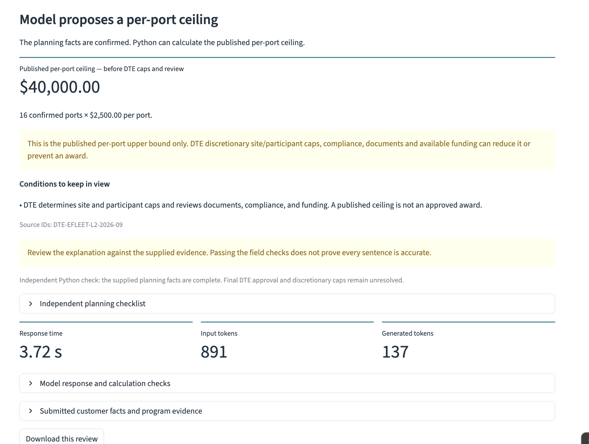
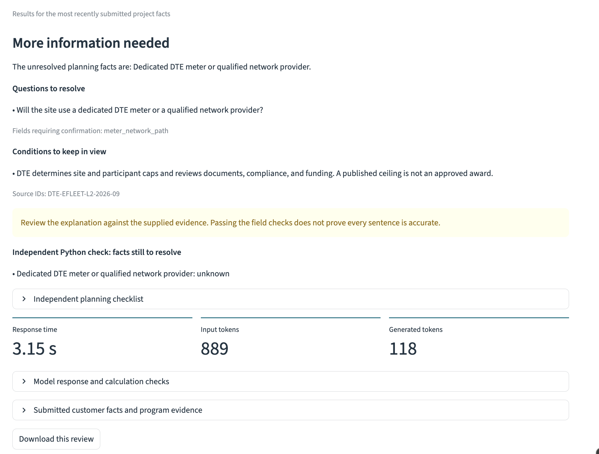
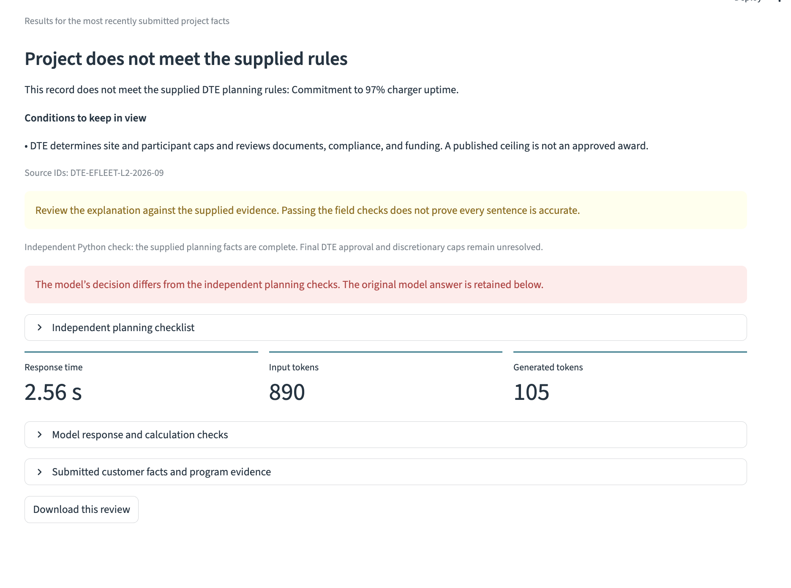

# Commercial Fleet EV Incentive Assistant

## Business problem

Fleet charging incentives depend on the serving utility, account status and project requirements. Sales teams need a clearer way to identify missing facts before discussing possible savings. This project explores a model that reviews supplied evidence, asks for clarification and hands supported calculation inputs to Python.

## Final Streamlit prototype

The application uses a fully fine-tuned Qwen2.5-0.5B-Instruct model, run `1bcf2a3b1d8e`, with a dated official DTE eFleet Level 2 rules snapshot. All customer examples are fictional. Python independently checks the supplied planning facts and any proposed calculation inputs. The interface retains the original model answer and flags decision disagreements.

- [Streamlit source and local setup](streamlit_app/README.md)
- [Main application file](streamlit_app/app.py)
- [Presentation with actual application screenshots](commercial_fleet_ev_incentive_assistant_presentation.pptx)
- [Executed DTE training notebook and later live evaluation](commercial_fleet_ev_incentive_assistant_dte_full_fine_tuning.ipynb)
- [Source ZIP](commercial_fleet_ev_incentive_assistant_streamlit_source.zip)
- [Recorded results and manual review](evaluation/)

GitHub Pages hosts the portfolio. The model application runs locally in Streamlit. Full model weights are separate from this repository. The completed bundle is `DSC670_DTE_Complete_1bcf2a3b1d8e.zip`. Its `app/`, `full_model/`, model manifest, completion record and recipe must stay together. The [Colab notebook](https://colab.research.google.com/github/danof2morrow/data-science-portfolio/blob/main/generative-ai/commercial-fleet-ev-incentive-assistant/commercial_fleet_ev_incentive_assistant_dte_full_fine_tuning.ipynb) reproduces a complete model bundle using a compatible GPU and Google Drive. Running it again may produce different weights or results.

## Official source and calculation scope

The [DTE eFleet program page](https://www.dteenergy.com/us/en/business/service-request/pev/efleet-charger-rebate.html) links the [September 2026 eFleet Charger Rebate Agreement](https://www.dteenergy.com/content/dam/dteenergy/deg/website/business/service-request/pev/efleet-charger-rebate/eFleetChargerRebateAgreement.pdf). The source review occurred November 8, 2026. [Document hashes](streamlit_app/source_review/receipt.json) and the [rules snapshot](streamlit_app/source_review/program_snapshot.json) document that review.

The reviewed rules supply up to $2,500 per Level 2 port, or $875 for Electric Choice customers. DTE retains discretion over site and participant caps and final review. The application reports only a published per-port ceiling before those decisions. It does not apply the earlier fictional cost-percentage limit, fixed cap or universal approval-before-purchase assumption. Customer confirmations are supplied inputs rather than independently verified facts. The app does not search current programs or check funding availability.

## Training and notebook evaluation

The new run starts from a pinned Qwen base revision and fully fine-tunes all 494,032,768 parameters. It uses 320 training, 64 validation and 64 test examples. Related project variants stay together in each split. Training completed four epochs and 160 optimizer steps on a Tesla T4 in 32.3 minutes. The notebook selected the lowest-validation-loss checkpoint, checked finite weights and verified saved file hashes before reloading the exported artifact for generation.

Validation loss decreased from 1.348316 to 0.004974. Teacher-forced assistant token accuracy increased from 72.02% to 99.82%. These validation token measurements differ from complete generated-answer accuracy.

| Generated-answer check | Authored notebook test | Six live app development cases |
|---|---:|---:|
| Valid JSON | 64/64 | 6/6 |
| Correct decision labels | 64/64 | 5/6 |
| Structured workflow checks | 64/64 | 5/6 |
| Ready cases with usable handoffs | 24/24 | 1/2 |

The 64 notebook cases contain four project groups with 16 counterfactual variants each. They share scenario families and answer templates with training, although exact records, project groups, port counts and task wording differ across splits. Their perfect structured score does not establish broad reliability. Manual inspection covered the 16 displayed notebook explanation samples. No separate report containing all 64 raw generations was supplied for this portfolio review.

## Actual live application results

The same saved model ran on Mac MPS and CPU. [MPS report](evaluation/dte_live_checks_mps.json), [CPU report](evaluation/dte_live_checks_cpu.json) and [manual explanation review](evaluation/dte_live_manual_review.json) preserve the original responses. Both devices generated identical response text for all six cases.

| Case | Model behavior | Application result |
|---|---|---|
| Complete planning example | Correctly proposes 16 ports at $2,500 per port | Python calculates a $40,000 published ceiling before DTE caps and review |
| Port count unconfirmed | Asks for port confirmation | No calculation |
| Meter or network path unconfirmed | Asks about either qualifying option | Python independently identifies the same missing fact |
| Electric Choice status unknown | Asks about account rate category | No calculation |
| Electric Choice customer | Incorrectly rejects a complete record and blames uptime although it is confirmed | Python marks the supplied facts ready and flags disagreement. No model handoff or amount. Reference ceiling: $14,000 |
| Different serving utility | Correct rejection label, incorrect uptime explanation | Python independently identifies the utility mismatch. Matching decision labels miss the explanation error |

Manual review found appropriate decisions and explanations in **4/6 live cases**. The six cases were already part of development and are not an additional independent accuracy study. A matching JSON structure or decision label does not verify the explanation.

### Complete planning example

### Missing meter or network arrangement

### Model error and independent disagreement

The screenshots correspond to the [complete review](evaluation/dte_complete_review.json), [missing-information review](evaluation/dte_meter_unknown_review.json) and [Electric Choice review](evaluation/dte_electric_choice_review.json). Individual response times were 3.718, 3.145 and 2.565 seconds respectively on MPS. These differ from the separate six-case batch timings.

## Reproducibility and limits

Twenty-one rule and response-validation tests pass. Both downloaded six-case live reports reproduce through the matching application's verifier. These code checks are separate from model performance. The recorded Colab run and local Mac inference are the actual execution evidence. The portfolio review environment did not train or run the model again.

The prototype demonstrates the required fine-tuned model in Streamlit, while its live failures limit it to reviewed course use. Further work should test unfamiliar wording, multiple missing or failed requirements and broader project combinations. Explanation assessment must remain separate from decision scoring. Current source verification, customer privacy controls and human review would be necessary before real customer use.

## Earlier project stages

The earlier artifacts remain as development history for this single project:

- [Prompt experiments](commercial_fleet_ev_incentive_assistant.ipynb), [initial report](commercial_fleet_ev_incentive_assistant_report.pdf) and [Python launcher](run_incentive_assistant.py). The historical Gemini workflow requires the user's own API key, model access and quota. No fresh Gemini execution is claimed.
- [Original fictional-program fine-tuning notebook](commercial_fleet_ev_incentive_assistant_fine_tuning.ipynb). Run `4ec6c67be487` recorded 25/28 strict checks and 26/28 correct decisions. Those scores describe the earlier fictional workflow. Its selected weights passed checks, although its training history recorded a non-finite metric.
- Earlier [official-program prompt-only reports](live_reviews/). The first prompt passed 0/6 structured workflows. A worked-example prompt passed 2/6 but produced inaccurate explanations in those two cases. Neither prompt supplied a complete-case calculation handoff. These failures motivated the separate DTE full fine-tuning run.
- The numbered historical screenshots and earlier fictional JSON reviews remain archived. The three `dte_` screenshots above describe the final application.

## References

DTE Energy. (2026, September). *eFleet charger rebate agreement*. https://www.dteenergy.com/content/dam/dteenergy/deg/website/business/service-request/pev/efleet-charger-rebate/eFleetChargerRebateAgreement.pdf

DTE Energy. (n.d.). *eFleet charger rebate*. Retrieved November 8, 2026, from https://www.dteenergy.com/us/en/business/service-request/pev/efleet-charger-rebate.html

Qwen. (n.d.). *Qwen2.5-0.5B-Instruct* [Language model, revision 7ae557604adf67be50417f59c2c2f167def9a775]. Hugging Face. https://huggingface.co/Qwen/Qwen2.5-0.5B-Instruct/tree/7ae557604adf67be50417f59c2c2f167def9a775

[Portfolio](../../index.html) · [Repository](../../README.md)
